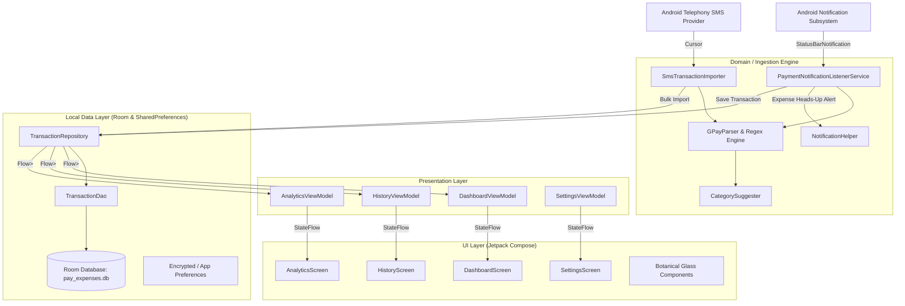
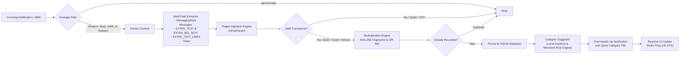
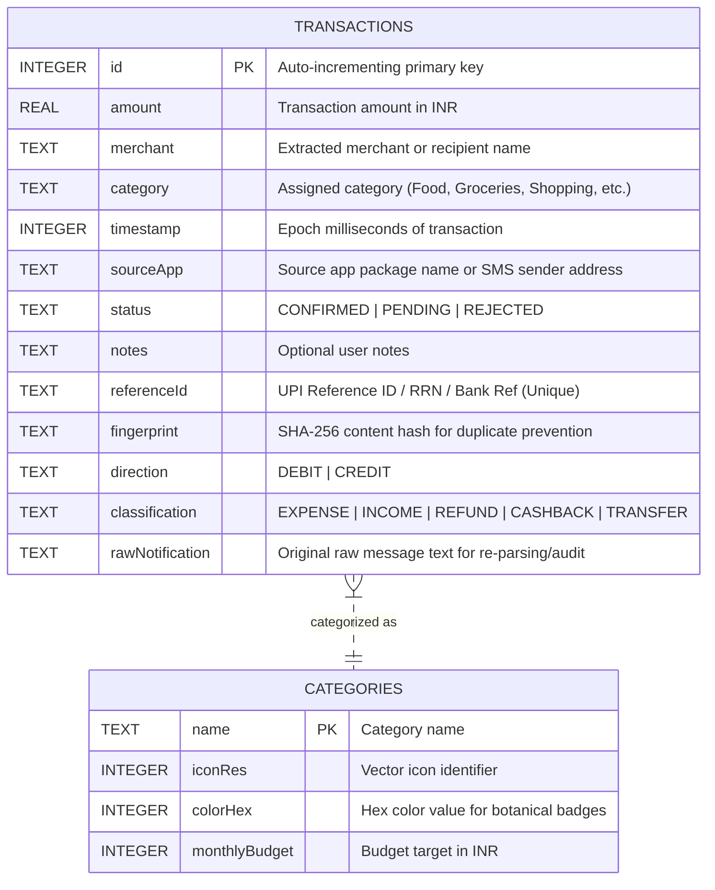

# Pay Tracker 🌿

> **Native, 100% Offline-First Personal Finance & Expense Tracker for Android**  
> Designed with the **Botanical Glass & Obsidian** design system. Engineered for high performance, zero cloud tracking, and automatic real-time transaction detection.

---

## 📖 Overview

**Pay Tracker** is an Android application that automatically tracks personal expenses and income in real time. It captures transaction notifications and bank SMS messages from UPI apps (Google Pay, PhonePe, Paytm, CRED, BHIM, etc.), banking institutions (HDFC, SBI, ICICI, Axis, Kotak, etc.), and food/commerce services (Swiggy, Zomato, Blinkit, Zepto, Uber) directly on your device.

- **Zero Cloud / 100% Private**: Your financial data never leaves your device. No analytics SDKs, no external trackers, no remote servers.
- **Real-Time Detection**: Automatically parses transaction amount, merchant name, UPI reference ID, debit/credit direction, and transaction type as notifications arrive.
- **Heads-Up Action Notifications**: Categorize expenses or adjust records directly from system notifications without opening the app.
- **Botanical Glass UI**: High-contrast, dark-mode visual interface with frosted glass containers, specular borders, and emerald accents.
- **Silky 120 FPS List Virtualization**: Granular, typed list recycling optimized for high-refresh rate displays (Nothing OS, Pixel, Samsung AMOLED).

---

## 🏗️ System Architecture

Pay Tracker follows the **Clean Architecture** pattern combined with **MVVM (Model-View-ViewModel)** and unidirectional reactive data flow via **Kotlin Coroutines Flow**.



---

## ⚡ Transaction Detection & Parsing Pipeline

The pipeline processes financial notifications with deduplication, regex matching, and multi-field extraction for Android 12–16:



---

## 🗄️ Database Schema

All transactions are stored locally on-device in a SQLite database managed via Android Room.



---

## 🛠️ Tech Stack & Libraries

| Layer / Concern | Technology / Library | Description |
| :--- | :--- | :--- |
| **Language** | Kotlin 2.0.21 | 100% native modern Kotlin |
| **UI Framework** | Jetpack Compose + Material 3 | Declarative UI with hardware-accelerated Compose runtime |
| **Design System** | Botanical Glass System | Frosted obsidian surfaces, specular gradient borders, Nothing OS aesthetic |
| **Architecture** | Clean Architecture + MVVM | Unidirectional Data Flow, separation of concerns, testable modules |
| **Concurrency** | Kotlin Coroutines & Flow | Non-blocking asynchronous I/O, reactive state pipelines (`StateFlow`) |
| **Local Persistence** | Android Room 2.6.1 + SQLite | Embedded relational database with schema migration support |
| **Code Generation** | KSP (Kotlin Symbol Processing) | High-performance annotation processor for Room |
| **Lifecycle** | AndroidX Lifecycle 2.8.6 | ViewModel, `LifecycleOwner`, and `compose.runtime` lifecycle integration |
| **System Services** | `NotificationListenerService` | Real-time notification interception without polling |
| **Testing** | JUnit 4 + Kotlin Test | Comprehensive unit test suite for regex parsers and flow calculators |
| **Build System** | Gradle 8.9 + AGP 8.7.0 | Modular Gradle build setup targeting Android API 26 through 35+ |

---

## 📱 Use Cases & Features

### 1. Automated Real-Time Expense & Income Capture
- Intercepts and parses real-time transaction alerts from:
  - **UPI Apps**: Google Pay (`com.google.android.apps.nbu.paisa.user`), PhonePe, Paytm, CRED, BHIM, Amazon Pay, WhatsApp Pay.
  - **Indian Banks**: HDFC, SBI, ICICI, Axis, Kotak Mahindra, Bank of Baroda, Canara, IDFC FIRST, IndusInd, Jupiter, Fi Money.
  - **Quick-Commerce & Delivery**: Swiggy, Zomato, Blinkit, Zepto, Uber, Ola, Rapido, Flipkart, Myntra.
- Supports debit messages (`"Paid ₹450 to Swiggy"`, `"debited for INR 1,200"`), credit messages (`"Received ₹2,000 from Amit"`, `"credited with Rs 500"`), refunds, and cashbacks.

### 2. High-Performance Dashboard
- **Hero Spending Velocity**: Tracks month-to-date spending, received income, and net cash flow at a glance.
- **Key Performance Indicators (KPIs)**:
  - **Transaction Count**: Total verified transactions this month.
  - **Top Category**: Dominant expense bucket with percentage share and category color badge.
  - **Peak Expense**: Largest single purchase of the current month with merchant details.

### 3. Silky 120 FPS History & Search
- Completely virtualized transaction list utilizing typed `HistoryListItem` headers and rows.
- Individual row recycling in `LazyColumn` eliminates layout lag and memory spikes.
- Search and filter by:
  - Query (merchant name, notes, reference ID)
  - Transaction Type (All, Expenses Only, Income Only)
  - Category (Food, Groceries, Shopping, Travel, Bills, etc.)
  - Date Range (Today, 7 Days, This Month, Last Month, Custom Calendar Range)

### 4. 1-Click Historical SMS Import
- Reads historical banking and financial SMS messages directly from the device's inbox.
- Automatic spam filtering excludes telemarketing, promotional messages, and OTPs.
- Automatic deduplication checks UPI reference IDs and SHA-256 transaction fingerprints to prevent duplicate entries.

### 5. Interactive Notifications
- Receive an instant heads-up alert when a transaction occurs with pre-selected category suggestion chips.
- Re-categorize or dismiss directly from the notification shade without unlocking or opening the app.

---

## 🔒 Permissions & Privacy

Pay Tracker operates under a strict **local-first privacy model**:

| Permission | Purpose |
| :--- | :--- |
| `BIND_NOTIFICATION_LISTENER_SERVICE` | Required to detect incoming transaction alerts from banking and UPI apps in real time. |
| `READ_SMS` | Optional. Used only when explicitly triggering historical SMS import from the dashboard. |
| `POST_NOTIFICATIONS` | Required on Android 13+ to show transaction confirmation heads-up alerts with quick actions. |

> **Privacy Guarantee**: Pay Tracker does **NOT** request or use the `android.permission.INTERNET` permission for expense tracking. All data is stored locally in an encrypted sandbox database on your phone.

---

## 🚀 Building & Installing

### Pre-built APK
The ready-to-install release APK is signed with the debug keystore for easy sideloading:
- **Direct APK**: [`PayTracker-v1.0.apk`](file:///home/edric/Documents/Pay/PayTracker-v1.0.apk) (13 MB)
- **Release Build Output**: `app/build/outputs/apk/release/app-release.apk`

### Building from Source

```bash
# 1. Clone repository
git clone https://github.com/Edric2412/PayTracker.git
cd PayTracker

# 2. Run unit tests
./gradlew testDebugUnitTest

# 3. Assemble Release APK
./gradlew assembleRelease

# 4. Install onto connected Android device via ADB
./gradlew installDebug
```

---

## 📄 License
This project is licensed under the MIT License — see the repository root for details.
